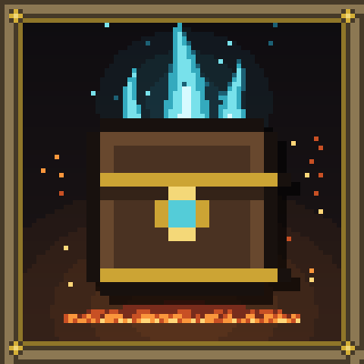

<p align="center"></p>

<h1 align="center">Casket of Echoes: Souls-Like Storage</h1>

<p align="center">A souls-like personal Casket you open at campfires, for Minecraft 1.20.1 (Forge).</p>

---

## Why this mod exists

I started playing **NightfallCraft: The Casket of Reveries** and I did not like their choice of storage.
The pack ships a tech-themed storage mod that felt out of place in a sword-and-magic, souls-like modpack.

I searched for a mod that would fit the theme and found nothing that suited my needs. So I decided to make it myself
(or rather, told Gemini Argon and Claude Opus 5.5 to make it 👀). The storage I wanted was something like the
Bottomless Box in *Dark Souls*, the storage chest in *Elden Ring* and the vestiges of *Lords of the Fallen*: you rest,
you open your Casket, you prepare, you leave.

## Features

- **Personal Casket** opened by resting at a lit campfire (or any block in `#soulsvault:rest_points`, or a craftable
  Bottomless Casket). Items live in the world's save data, never on the player, so huge NBT items can't bloat player
  files.
- **Auto-sorted tabs** (Weapons, Ranged & Ammo, Armor, Curios & Relics, Consumables, Materials, Key & Lore), sorting,
  `@mod` / `#tag` search, large stacks and an inspect pane with a 3D preview.
- **Rest & Replenish** tops pinned consumables and ammo back up to a carry target; **overflow** sends pickups to the
  Casket when your inventory is full.
- **Build Echoes**: saved loadouts (hands, armor, Curios) swapped in one click at a Rest Point.
- **Keepsakes**, a small private stash; **Reliquary Shards** and **Echo Pouches** for upgrades; the **Vestige Moth**
  summons a temporary Spectral Casket before a boss.
- **Progression and limits**: Casket Attunement, remote-access cost, combat lock, optional Equip Load.
- **Parties**: built-in or FTB Teams / Open Parties and Claims / vanilla teams, a shared Covenant Casket, party HUD with
  3D portraits, teammate markers in the world and on Xaero's Minimap and World Map.

Optional integrations: Curios, Epic Fight, JEI, EMI, REI, FTB Teams, FTB Quests, Open Parties and Claims, Quark, Xaero's
Minimap and World Map, HungerStrike. None are required.

## For modpack makers

Server rules live in `soulsvault-server.toml`, player preferences in `soulsvault-client.toml`; Rest Points, replenish
caps, equip load weights and category tags are datapack-driven. There are milestone advancements, `/casket` commands,
Forge events for KubeJS and a small Java API. Everything is described in the
**[modpack guide](docs/PACK_GUIDE.md)**.

## Building

Requires JDK 17.

```bash
./gradlew build
```

The mod jar is written to `forge/build/libs/`. The project uses the MultiLoader layout:

- `common/` holds the logic and UI against vanilla Minecraft (no loader imports); platform calls go through
  `IPlatformHelper`, loaded with `ServiceLoader`.
- `forge/` holds the Forge entrypoint, saved data, networking, events and compatibility bridges.
- Item identity is `ItemKey` (item plus NBT), Casket contents are stored in Overworld `SavedData`, Vault sync is chunked
  with single-entry deltas, and every third-party integration is optional (reflection or compile-only APIs).

## How it was made

The idea, the feature design and the decisions about how it should play are mine, but about 90% of the code was
written and reviewed with AI tools. Bug reports are very welcome in
[Issues](https://github.com/YassaaaTU/casket-of-echoes/issues).

I tested the mod in the NightfallCraft: The Casket of Reveries modpack, both locally and on a dedicated server.

## Versioning

1.0.0 is the first public release. The version numbers you may see earlier in the commit history (1.1.0 to 1.4.0)
were private development builds tested in The Casket of Reveries before release.

## License

[MIT](LICENSE). You're welcome to include it in modpacks.
